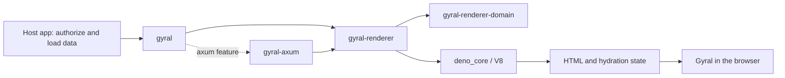

# Architecture

The host Rust application authorizes a page request and loads its data. It passes
a validated `RenderRequest` to `gyral-renderer`, which executes the application's
compiled Gyral components. `gyral-axum` returns the resulting HTML. Gyral in the
browser hydrates the same components. Applications reach both through the `gyral`
front-door crate.

## Package boundaries

`gyral-renderer-domain` contains pure constructors and the rendering contract.
It depends only on Serde, JSON, typed errors, and pure Base64 encoding. It cannot reference runtime,
HTTP, or infrastructure crates. `gyral-renderer` re-exports its validated types
and supplies a `RenderService` capability and embedded implementation.
`gyral-axum` depends on that capability and Axum. It does not choose routes, load
data, or decide whether a caller is allowed to see a page.

`gyral` is the front door and contains no logic. Its root re-exports the
`gyral-renderer` API, and its optional `axum` feature re-exports `gyral-axum` as
`gyral::axum`. It depends only on those two crates, so the boundaries above stay
in the building blocks. All four crates publish to crates.io with one shared
version; the examples stay unpublished. The [release runbook](docs/releasing.md)
covers publication order and dependency requirements.

The SSR example is the composition root. It depends on `gyral` with the `axum`
feature, which exercises the front door's re-exports. Its startup bounds file
reads, parses the manifest, verifies server and browser bytes through
`AppArtifacts`, initializes the V8 platform before worker threads start, creates
the renderer, and wires Axum. `tools/check.py` verifies package dependency directions and
checks the domain for direct I/O and runtime references.

## Askama pages with client rendering

The separate `gyral-askama-client-example` renders its document through Askama.
Axum parses the name and starting count into private validated types; Askama
escapes their text and quoted attributes. The response contains custom-element
tags and fallback text. Gyral registers those elements and performs their first
render in the browser. No component contents are prerendered or hydrated.

This application depends directly on Axum, Askama, and the domain's pure
`ContentHash` type. It does not use the renderer or HTTP rendering adapter.
Its host-owned asset loader verifies a client manifest and JavaScript/CSS
bytes before HTTP binds. It serves only the two derived asset URLs from memory.
The client manifest has its own format version, without a server bundle or SSR ABI.

The notes application uses normal GET pages and URL-encoded POST forms. Two
unpublished example crates demonstrate the application boundary:
`gyral-example-notes-domain` holds pure, private-field types; `gyral-example-notes-app`
defines storage ports and owns begin/write/commit workflows. Neither depends on
Axum or SQLx. The executable wires the SQLite adapter, notebook policy, templates,
and assets at startup. These example crates do not expand the renderer API.

An operating-system random cookie is an anonymous notebook capability. All reads
and writes include that notebook in their SQL condition. Rust verifies a
session-bound HMAC CSRF proof before mutation, decodes form fields once, and
returns a 303 redirect after committing. Invalid fields return a 422 page with
preserved input and accessible errors. Expired proofs and full notebooks also
retain the draft, returning 403 and 409 respectively.

The workflow starts an immediate SQLite transaction. Conditional writes enforce
ownership and a 200-note quota atomically; dropping an uncommitted transaction
rolls back. Numbered migrations run before HTTP binds. SQLx query macros use
checked metadata for offline builds, and CI verifies that metadata against an
empty database built from the migrations. Flat database rows re-enter the domain
through validated constructors. The pool closes after HTTP drains.

Gyral observes the native title and textarea through a subscription driver. Its
pure view renders a preview and character count in a shadow root, with no input
controls or submission logic. The driver reads existing values on upgrade and
releases its listener on disconnect. Successful form controls stay in Askama's
light DOM. See [the design](docs/design/askama-client.md) for the routes, cookie
lifetime, persistence, and shadow/form boundary.

## Runtime ownership

`Renderer::start` returns a cloneable handle and a `RendererWorker` lifecycle
owner. One dedicated Rust thread receives work through a sixteen-position
bounded queue. A full queue returns `RenderError::Busy`; the Axum adapter maps
that to 503. A second thread supervises the active isolate's deadline and
cancellation signal. JavaScript rendering never runs on Axum's asynchronous executor.

The scaffold creates a fresh V8 isolate and evaluates the app bundle for each
request. This discards module globals and request stores between renders. It
also repeats runtime initialization and bundle evaluation; a bounded synthetic load profile is documented in [operations](docs/design/operations-and-release.md).
It does not establish an application capacity claim. Pooling and snapshots must preserve request isolation.

A dropped render future cancels queued work or interrupts active JavaScript.
The default end-to-end deadline is two seconds, including queue time. The runtime
requests a 64 MiB managed-heap budget and terminates execution near that limit;
this does not cap process memory. Rust render unwinds are caught and the next
request starts a fresh isolate. Read the [resource policy](docs/design/runtime-limits.md)
for exact limits, termination headroom, and native failure boundaries.

The example probes its actual bundle before binding HTTP and periodically afterward.
Readiness combines fresh probe evidence, renderer lifecycle, and host admission.
Signal shutdown withdraws readiness before draining HTTP; request spans cross
the renderer thread, while metrics retain finite outcome labels.
Read [operations](docs/design/operations-and-release.md) for the host-owned policy.

After HTTP requests drain, the application calls `worker.shutdown()` to close
admission, drain accepted messages, and join both threads within a two-second
default budget. Expiry interrupts active JavaScript and reports a typed failure.
Dropping the owner closes admission and interrupts execution without waiting
for cleanup; cancelling the shutdown future has the same fallback behavior.

## Rendering and hydration

The bundle contract is [versioned separately](docs/design/bundle-contract.md)
from HTTP. JavaScript receives JSON data and returns a string or a promise of a
string. After bundle evaluation the runtime requires `gyralBundleVersion = 1`
before invoking the entrypoint. The example bundles Gyral `0.3.7`, renders through its own SSR
implementation, and builds a matching hydration bundle. Rust does not reproduce
Gyral's HTML escaping, component serialization, or hydration protocol.

The example supplies a small UTF-8 `TextEncoder.encode` shim for Gyral's style
hasher and includes ICU data for date/time formatting. It does not provide a
DOM, Node compatibility layer, network client, or filesystem API to app code.
Gyral commands do not run during SSR; apps load initial data before rendering.

## HTTP policy

Rendered documents default to `Cache-Control: no-store` and
`X-Content-Type-Options: nosniff`. Applications choose status codes. Overload and
worker unavailability, deadline expiry, and cancellation become 503; heap failures
and other render defects become an opaque 500.
The adapter omits JavaScript diagnostics from both response bodies and its logs,
because a thrown error can contain private props. Applications can inspect typed
errors through their own rendering capability and apply an explicit redaction policy.

Hosts own CSP, search exclusion, authentication cookies, authorized DTOs, asset
URLs, and public caching. The build compiles a full-digest browser URL and SRI
token into the server source, then writes their shared manifest. Startup verifies
both files. The example serves only the verified browser bytes from memory with
immutable caching; misses and unsupported methods are not cached.

The adapter supplies a restrictive `DocumentPolicy` for the manifest's browser
entry and static styles. The example applies it to successful documents and
render failures. Applications with other resource needs own their policy design.
Read [assets and CSP](docs/design/assets-and-csp.md) for compatibility coverage,
header limits, and deployment boundaries.
