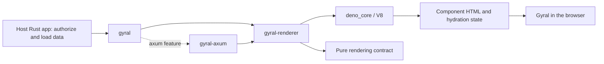

# gyral-rs

[](https://github.com/gyraljs/gyral-rs/actions/workflows/ci.yml)
[](LICENSE)
[](rust-toolchain.toml)
[](https://www.npmjs.com/package/@gyral/core/v/0.3.8)
[](https://github.com/gyraljs/gyral-rs/stargazers)
[](https://github.com/gyraljs/gyral-rs/forks)
[](https://github.com/gyraljs/gyral-rs/graphs/contributors)
[](https://github.com/gyraljs/gyral-rs/issues)
[](https://github.com/gyraljs/gyral-rs/pulls)
[](https://github.com/gyraljs/gyral-rs/commits/main/)

**Render Gyral components inside Rust, then hydrate them in the browser.**

`gyral-rs` embeds [Gyral](https://gyral.dev) server rendering through
[`deno_core`](https://docs.rs/deno_core/0.412.0/deno_core/). Your Rust application
owns routes, authorization, data loading, and mutations. The renderer receives
an approved JSON view of that data and returns the application's HTML. Gyral in
the browser adopts the rendered components and activates their behavior.

The repository also demonstrates a multi-page Axum application with Askama
templates, native HTML forms, and Gyral components that render in the browser.
You can use that pattern independently of the embedded renderer.

## Why this exists

A Rust application may already own authentication, database access, and HTTP
responses while its views use web components. Server rendering should fit that
ownership: Rust prepares the page data, the application's Gyral bundle renders
its components, and the browser continues from the same component state.

The embedded path keeps rendering in the Rust process. Node builds the
JavaScript bundles; it is absent from the running server. Rust supplies a bounded
worker lifecycle, deadlines, cancellation, verified assets, and HTTP integration.
Gyral owns its HTML serialization and hydration protocol.

For pages whose components can render after navigation, the Askama example
shows another useful path. Rust sends the document, custom-element tags, form
controls, and fallback content. Gyral upgrades the components in the browser;
ordinary form submissions still reach Rust with JavaScript disabled.

## Status and compatibility

This is an experimental, pre-1.0 workspace with executable examples and recorded
[verification evidence](docs/verification.md). The four crates are on
[crates.io](https://crates.io/crates/gyral) (`cargo add gyral`). Version 0.5.0
accepts bundles built with Gyral **0.3.7**; the [changelog](CHANGELOG.md) names the Gyral
release each earlier version accepts. The
examples install the exact published `@gyral/core` and `@gyral/ssr` **0.3.8**
packages from npm.

The supported embedded build is **Linux x86_64 GNU**, **Rust 1.99.1**, edition
2024, with `deno_core` **0.412.0** and V8 **150.4.0**. Other targets have no tested
support claim. The examples use synthetic data; complete application compatibility
and workload-specific deployment targets still need application-level evidence.

The renderer accepts reviewed application bundles. Its resource controls and
restricted JavaScript APIs do not make it an untrusted-code sandbox. Read the
[security boundary](docs/security.md) before embedding it in a service.

## Use it from your application

Add the front-door crate, with the Axum adapter if you serve pages through Axum:

```sh
cargo add gyral serde_json
cargo add gyral --features axum
```

`gyral` re-exports the renderer and its validated types at its root, and the
adapter as `gyral::axum`. The [crate README](crates/gyral/README.md) shows a first
request; the [SSR example](examples/axum-app) uses the same dependency. Building
it links V8, so pin and verify the native archive as the
[renderer guide](crates/gyral-renderer/README.md#pin-the-native-v8-archive) explains.

## Choose a rendering path

| | Embedded SSR and hydration | Askama pages and browser components |
| --- | --- | --- |
| Document generation | Rust invokes the app's Gyral SSR bundle. | Rust renders Askama templates. |
| Component execution on the server | `deno_core` and V8 execute the reviewed bundle. | No JavaScript engine or component execution. |
| Browser behavior | Gyral hydrates existing component HTML. | Gyral performs each component's first render. |
| Application responsibility | Routes, permissions, approved DTOs, mutations, and response policy. | Routes, permissions, native form processing, templates, and persistence. |
| Example | Greeting, counter, shared store, name form, and time. | Notes CRUD, validation, redirects, and a live preview. |
| Local URL | <http://127.0.0.1:3037/> | <http://127.0.0.1:3038/notes> |

## Quick start

Install Rust 1.99.1, Node 24.22.0, pnpm 12.14.0, Python 3.11 or later, and GNU
Make. Use the [development guide](docs/development.md) for the additional tools
required by the full test gate.

```sh
git clone https://github.com/gyraljs/gyral-rs.git
cd gyral-rs
corepack enable
corepack prepare pnpm@12.14.0 --activate
pnpm install --frozen-lockfile
```

### Embedded SSR

```sh
make demo
```

This verifies the pinned native V8 archive, builds both examples' assets and Rust
executables, and starts the SSR example. Open <http://127.0.0.1:3037/?name=Mike>.
The response already contains the component HTML; browser hydration activates
the controls under an enforcing content security policy. Ctrl+C stops the server
and joins its rendering workers.

The first native build downloads the reviewed V8 archive. Before using raw Cargo
commands that build the renderer, run `make prepare-native`; root Make targets
prepare it automatically. Cargo configuration is local to this checkout, so
applications must adopt the same native preparation and pin; the
[renderer guide](crates/gyral-renderer/README.md#pin-the-native-v8-archive) lists
the steps. See the [supported build policy](docs/design/operations-and-release.md).

### Askama and native forms

In another terminal, or after stopping the SSR example:

```sh
make client-demo
```

Open <http://127.0.0.1:3038/notes>. Create, read, edit, and delete notes through
normal pages and HTML forms. Rust validates input, checks notebook ownership and
CSRF proofs, and commits changes to SQLite. Successful writes redirect; invalid
submissions retain the draft and explain the errors. Gyral supplies a live
preview without owning form submission.

This build excludes `gyral-renderer`, `gyral-axum`, `deno_core`, and V8. It needs
Node for browser assets and no JavaScript engine in the running Rust process.
The greeting/counter page remains at <http://127.0.0.1:3038/?name=Mike&start=5>.

Keep the notebook cookie to return to the same notes. The default database is
`.local/notes.sqlite`; restarting preserves data and expires forms opened before
the restart. This anonymous notebook is a demonstration, with no account recovery
or production identity service. See the [Askama design](docs/design/askama-client.md).

## Architecture

Applications depend on one front-door crate. Three building blocks behind it
keep the runtime, HTTP adapter, and pure contract separate:

| Package | Responsibility |
| --- | --- |
| [`gyral`](crates/gyral) | Front door: re-exports the renderer API, and the Axum adapter as `gyral::axum` with the `axum` feature. |
| [`gyral-renderer`](crates/gyral-renderer) | Execute a trusted bundle through a bounded embedded runtime and return validated HTML. |
| [`gyral-axum`](crates/gyral-axum) | Map rendering results to Axum responses with private caching and opaque errors. |
| [`gyral-renderer-domain`](crates/domain) | Define validated requests, limits, manifests, and HTML without runtime or HTTP dependencies. |



One renderer owns an execution thread, a watchdog thread, and a sixteen-position
queue. JavaScript runs away from Axum's async executor. Each request creates a
fresh isolate and evaluates the app bundle, discarding module globals and request
stores afterward. Dropping a render future cancels queued work or interrupts
active JavaScript. The host drains HTTP and explicitly shuts down the worker.

Startup verifies the server bundle, browser bundle, and manifest as one artifact
set. The example serves content-hashed assets with integrity metadata and an
enforcing CSP. The adapter defaults to `no-store`, `nosniff`, and fixed error
bodies. Applications own their identity, DTO filtering, CSP needs, and caching.

Read [architecture](ARCHITECTURE.md), the [bundle contract](docs/design/bundle-contract.md),
and [assets and CSP](docs/design/assets-and-csp.md) for the detailed boundaries.

## Configuration

These variables configure the example executables at startup:

| Variable | Default | Purpose |
| --- | --- | --- |
| `GYRAL_EXAMPLE_BIND` | `127.0.0.1:3037` | SSR listen address. |
| `GYRAL_EXAMPLE_DIST` | `examples/axum-app/dist` in the checkout | Verified SSR artifact directory. |
| `GYRAL_CLIENT_BIND` | `127.0.0.1:3038` | Askama listen address. |
| `GYRAL_CLIENT_DIST` | `examples/askama-client-app/dist` in the checkout | Verified browser JavaScript and CSS directory. |
| `GYRAL_NOTES_DB` | `.local/notes.sqlite` in the checkout | Persistent notes database path. |
| `GYRAL_OTLP_ENDPOINT` | Unset; export disabled | SSR HTTP/protobuf trace endpoint, including `/v1/traces`. |
| `RUST_LOG` | `info,hyper=warn,reqwest=warn` | SSR log filter. |

Paths default from the example's compiled project directory; set explicit paths
when moving a binary. A missing, substituted, or mixed artifact set prevents
HTTP startup. Rebuild the matching artifacts instead of editing manifest hashes.

Library users configure `RenderLimits` and pass them to `Renderer::with_limits`:

| Limit | Default | Meaning |
| --- | --- | --- |
| Render deadline | 2 seconds | Includes queue time, initialization, rendering, and output handling. |
| Managed V8 heap | 64 MiB | Managed heap policy, with termination headroom; not a process RSS cap. |
| Worker shutdown | 2 seconds | Budget for draining and confirming joined threads. |

The runtime exposes no application network or filesystem API. Rust loads the
data before rendering and supplies only values permitted in the browser. See
[runtime limits](docs/design/runtime-limits.md) for ranges and failure semantics.

## Build and verify

Install the pinned test tools and Chromium/WebKit as described in
[development](docs/development.md), then choose the relevant gate:

| Command | Result |
| --- | --- |
| `make build` | Both examples' bundles and Rust executables. |
| `make client-build` | Askama browser assets and executable, without V8. |
| `make check` | Policy, formatting, and strict Clippy. |
| `make test` | Native tests and Rust documentation tests. |
| `make browser` | SSR and hydration checks in Chromium and WebKit. |
| `make client-browser` | Client-only rendering and notes, including forms without JavaScript. |
| `make ci` | Complete local code, artifact, browser, SQL, operating, and dependency gate. |
| `make package` | Publish dry-run of the four crates, package contents, and an offline docs.rs build. |
| `make load` | Bounded release fixture regression profile; not an application capacity claim. |
| `make evaluate-runtime` | Test-only startup snapshot and worker comparisons. |
| `make release-evidence` | Tested container plus local archives, inventories, descriptor, and checksums. |

[GitHub Actions](.github/workflows/ci.yml) runs the local gate, container checks,
release assembly, fixture load profile, and package checks. The owner publishes
to crates.io through a manually started [release workflow](.github/workflows/release.yml)
described in [releasing](docs/releasing.md). Recorded results and their limits are
in [verification](docs/verification.md). Snapshot measurements live in
[runtime evaluation](docs/design/runtime-evaluation.md); production rendering
still evaluates a bundle in a fresh isolate for each request.

## Docker and deployment

Build and run the SSR reference image:

```sh
make docker
docker run --rm --name gyral-ssr --publish 127.0.0.1:3037:3037 --stop-timeout 15 gyral-rs:example
```

From another terminal, `docker stop --time 15 gyral-ssr` sends SIGTERM and allows
HTTP drain, renderer shutdown, and telemetry flush. `/livez` reports reachability;
`/readyz` combines recent bundle probes, worker state, and host admission.
`/metrics` exposes bounded Prometheus labels. Run `make docker-smoke` to check the
reference image.

For Askama with a persistent notebook volume:

```sh
make client-docker
docker volume create gyral-notes-data
docker run --rm --name gyral-notes --publish 127.0.0.1:3038:3038 --stop-timeout 15 \
  --mount type=volume,source=gyral-notes-data,target=/app/data gyral-rs:askama-client
```

The database and notebook cookie preserve access across container replacement.
`docker stop --time 15 gyral-notes` drains HTTP and closes SQLite. Run
`make client-docker-smoke` to verify the independent client image.

Both images target `linux/amd64`, use multi-stage builds, run as UID 10001, and
omit Node from the final image. The Askama image also omits V8. Production
applications supply HTTPS, authenticated identities, storage retention, process
resource limits, and workload-specific evidence. The local notes cookie is an
HTTP demonstration and does not set `Secure`.

The [operations and release guide](docs/design/operations-and-release.md) covers
native archive integrity, tracing, graceful stop budgets, semver, local release
artifacts, and distribution. These commands build local images and evidence;
they do not publish crates, images, or a hosted service.

## Project conventions

- Keep the domain pure; applications own permissions, transactions, and mutations.
- Parse external values into private-field types and return named error enums.
- Bound queues and background work, preserve cancellation, and join worker owners.
- Pin Rust, JavaScript, native archives, container inputs, and copied skill sources.
- Keep durable designs and tested evidence in `docs/`; maintainers track implementation
  status and dependencies in local [Beads](https://github.com/gastownhall/beads).
- Keep databases, credentials, generated assets, release output, and Beads records
  outside Git. Use synthetic data in examples and reports.

[AGENTS.md](AGENTS.md) is the repository map for contributors and coding agents.
[Engineering](docs/engineering.md) records the stack and pinned skills;
[writing conventions](docs/writing.md) keep documentation precise and readable.

## Contributing and community

Bug reports, reproducible compatibility cases, documentation improvements, and
focused pull requests are welcome. Start with [CONTRIBUTING.md](CONTRIBUTING.md)
for setup, relevant checks, DCO sign-off, and the contribution workflow. Discuss
substantial API or runtime changes in a [GitHub issue](https://github.com/gyraljs/gyral-rs/issues)
before implementing them.

Follow the [Code of Conduct](CODE_OF_CONDUCT.md). Report vulnerabilities through
the private channel in [SECURITY.md](SECURITY.md). The framework and its TypeScript
packages live in [gyraljs/gyral](https://github.com/gyraljs/gyral); Gyral guides
and API reference are at [gyral.dev](https://gyral.dev).

## License

Project code is available under the [MIT License](LICENSE). Dependency licenses
and copied reference attribution remain with their owners; see
[third-party notices](THIRD_PARTY_NOTICES.md).
